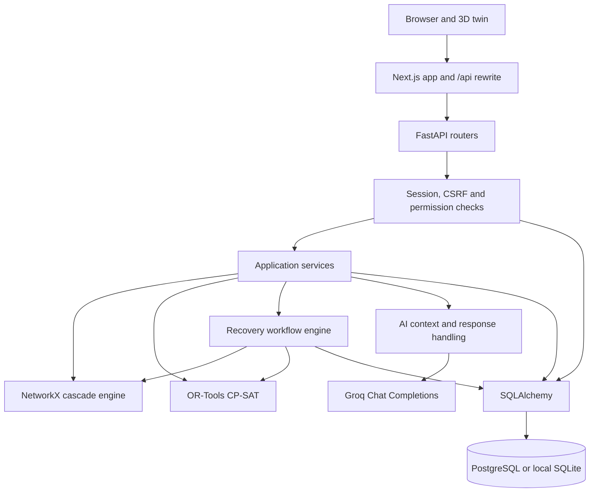
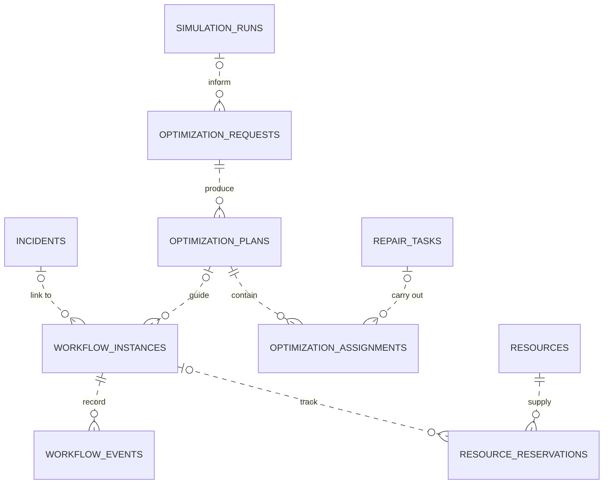
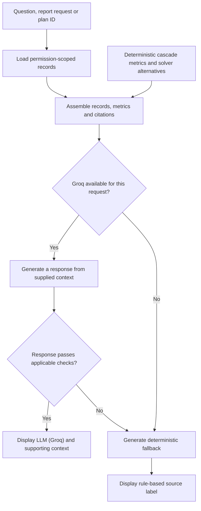
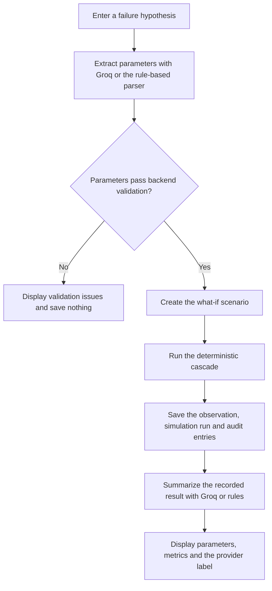
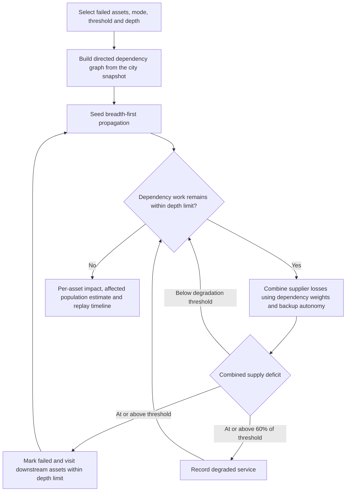
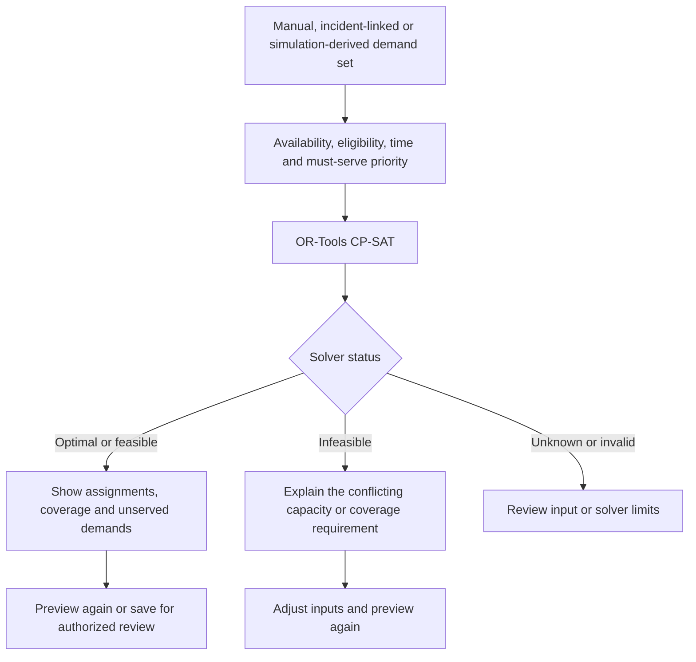
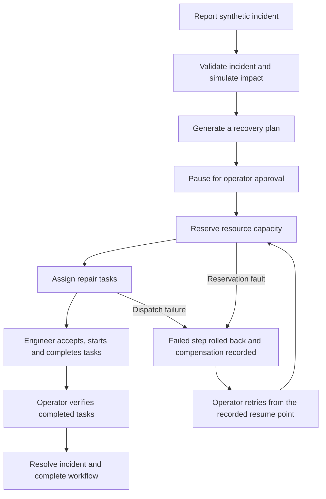
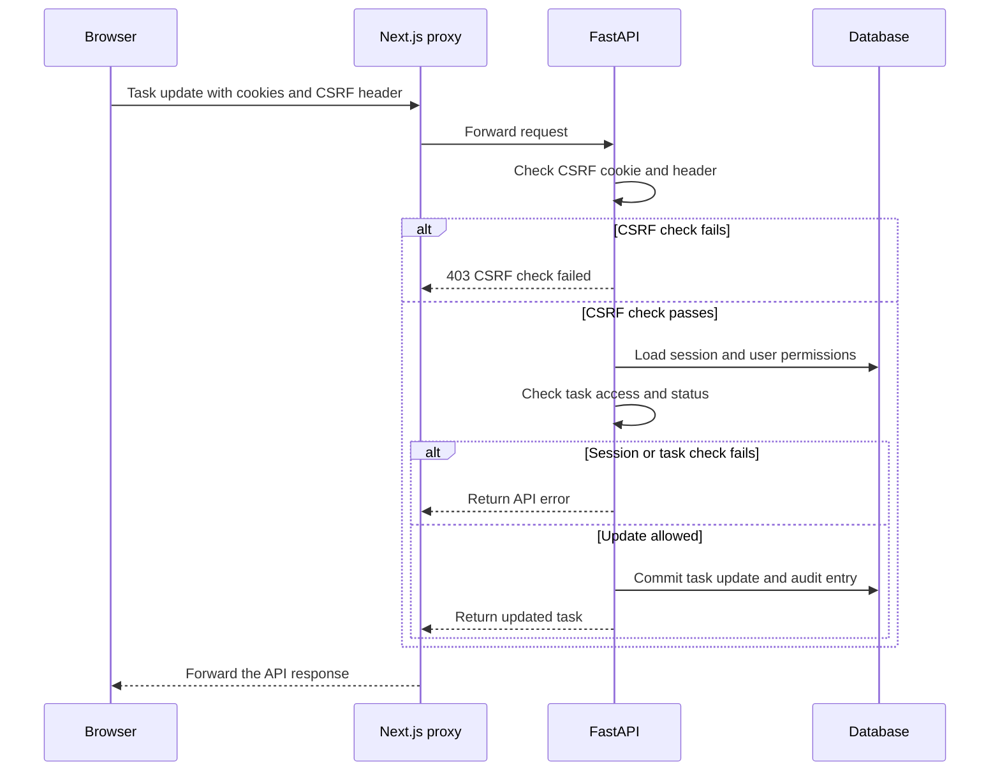

# SYMBIOTIC CITY

**Self-Healing Urban Intelligence**

An AI-assisted urban infrastructure resilience platform combining an interactive 3D digital twin,
cascading-failure simulation, constrained recovery optimization, and auditable operational workflows.

**[Launch the live demo][demo] · [Watch the competition video][video]** · [GitHub repository][repo] ·
[Backend health check][health]

[](#competition-information)


In a city where water pumps, hospitals, and telecom exchanges share power supplies, one outage can
disrupt several services. Symbiotic City lets a team rehearse those dependencies and test recovery
options in **Aurora Vale**, a fictional city built entirely from synthetic data.

## Judge Quick Start — Test the Live Application

### 1. Open the live website

Open the [live demo][demo] and go to [Sign in][login]. The frontend or API can take a moment to wake
after inactivity on Render's free tier. The [backend health check][health] shows when the API is
responding. [Render free-tier behavior](https://render.com/docs/free#spinning-down-on-idle)

| Service | Link |
| --- | --- |
| Live website | [symbiotic-city-web.onrender.com][demo] |
| Backend API | [symbiotic-city-api.onrender.com][api] |
| Backend health check | [API health][health] |
| Frontend proxy health | [Proxy health][proxy-health] |
| API documentation | [Swagger / OpenAPI][api-docs] |

### 2. Sign in with a synthetic demo account

| Role | Email | Demo password | Start here |
| --- | --- | --- | --- |
| **Super Admin** | `admin@symbiotic.city` | `Admin#2026` | Use the [user administration][users] and [audit log][audit] pages. |
| **City Operator** | `operator@symbiotic.city` | `Operator#2026` | Use [Incidents][incidents], [Workflows][workflows], and [Tasks][tasks] for coordination and approvals. |
| **City Analyst** | `analyst@symbiotic.city` | `Analyst#2026` | Recommended for the [dashboard][dashboard], [3D twin][twin], AI responses, [A02 preview](#5-verify-a02-without-saving-a-plan), and workflow history. |
| **Field Engineer** | `engineer@symbiotic.city` | `Engineer#2026` | Open [My Assigned Tasks][my-tasks] to inspect the field workspace and task details. |
| **Field Engineer 2** | `engineer2@symbiotic.city` | `Engineer#2026` | A second field account for reviewing task assignment and role-based access. |

These accounts use shared synthetic data. Use the live site for browsing, read-only AI requests, and
**Preview solve**. Watch the video for approval and fault recovery, or use an
[isolated local instance](#local-installation) to create records, approve plans, inject faults, and
advance tasks. The [local role guide](#local-demo-roles) covers the City Operator and Super Admin roles.

### 3. Explore Aurora Vale

Open the [3D twin][twin], select **PS-01**, and inspect its downstream dependencies. Open the
[Failure Simulation Lab][simulation] to view existing runs. The [Resilience Intelligence][resilience]
page shows how asset criticality and risk vary across the city.

### 4. Verify the seven Groq AI features

The City Analyst can use all seven entry points. The first six can be tried on the shared demo. Use an
isolated local instance for the final one, which saves a scenario and its run when validation succeeds.

| Feature | Where to go and what to try |
| --- | --- |
| **City Copilot** | [Dashboard][dashboard] → **City Copilot**. Ask “Which assets depend on SS-01, and which critical services should I check first?” |
| **AI Disaster Commander** | [Dashboard][dashboard] → **Disaster Commander**. Ask “If PS-01 fails, what happens to Aurora Vale, and what should we do first?” |
| **Multi-Scenario AI Reasoning** | [Resilience][resilience] → **What-if futures** → **Multi-scenario AI reasoning**. Enter “Compare PS-01 failure versus SS-01 failure” and click **Compare**. Inspect the side-by-side cascade metrics and trade-offs. |
| **Explainable Recovery Intelligence** | [Optimization][optimization] → **Plans**. Open an existing feasible or optimal plan and click **Explain plan & compare alternatives**. Review what changed across the solver reruns. |
| **AI Resilience Report** | [Resilience][resilience] → **Generate report**. Review the summary, critical assets, and supporting citations. This action uses existing records. |
| **Incident Explanation** | [Incidents][incidents] → open an existing incident → **Explain this incident**. Review the affected asset and related repair work. |
| **Natural-Language What-if** | On local `/simulation`, find **Describe a failure in plain language**. Enter “What if TX-01 and SS-02 fail at once? Threshold 0.6, depth 5, seed 99” and click **Extract & run**. Check the extracted parameters and the saved run. |

Check the provider label on each response. **LLM (Groq)** identifies a model response. A **rule-based**
label identifies deterministic output, such as a fallback when the provider is unavailable, a response
is incomplete, or a grounding check rejects it. [Watch the competition demonstration][video]

### 5. Verify A02 without saving a plan

1. As City Analyst, open [Optimization][optimization] → **Compose demand**. Keep **Manual selection**,
   click **Add demand**, and select **HO-01 · Aurora Central Hospital**.
2. Set the demand to **100 kVA**, priority to **1**, **Horizon (hours)** to **12**, and
   **Must serve priority** to **Priority ≤ 1**. Leave **Force infeasible** off and click **Preview solve**.
   On the seeded resource pool, you should see **Feasible plan** with an `optimal` status, **1/1**
   covered, and the resource assignments. Live capacity can vary with existing reservations.
3. Turn on **Force infeasible** and click **Preview solve** again. This multiplies the request by four,
   so the same mandatory hospital now needs **400 kVA**. The solver returns `infeasible` when the
   eligible capacity cannot meet that floor. **No feasible allocation** identifies the shortfall.
   The demand editor still displays the unscaled input.
4. Compare the assignments and coverage with the infeasibility explanation. Clear the toggle to restore
   the baseline. **Preview solve** writes no requests, plans, or resource reservations.
   **Solve & persist** saves a request and plan and requires `optimization:run`.
   Approval and reservations require `optimization:approve`.

[Solver statuses, constraints, and tests](#a02--intelligent-decisions--optimization)

### 6. Verify A07 recovery

On the live site, open [Workflows][workflows] as City Analyst and inspect an existing run's **Progress**,
**Compensation**, and **Event ledger**. Watch the [competition video][video] or follow the
[isolated A07 walkthrough](#a07--automated-multi-step-workflow) to report an incident, trigger a
reservation failure, verify compensation, retry, and complete recovery. The workflow requires a City
Operator for approvals and coordination and a Field Engineer for assigned repairs.

### 7. Check role-based access

Compare the City Analyst sidebar with the Field Engineer sidebar. Analysts see Optimization and
Workflows. Engineers see **My Assigned Tasks** and can act on tasks assigned to them. The application
loads effective permissions for the signed-in user, and FastAPI enforces them on every protected route.

[Features](#key-features) · [Architecture](#system-architecture) ·
[Competition compliance](#competition-compliance) · [Local installation](#local-installation) ·
[Testing](#testing-and-validation)

## Project overview

A restoration plan depends on which assets failed, what still works, and which resources can reach
critical services in time. A power failure can affect water distribution and telecom, and their loss can
affect facilities that appear unrelated when viewed in a single sector.

Symbiotic City connects a dependency model and 3D twin to a deterministic simulator, a constrained
recovery planner, and an incident workflow. Operators can track synthetic conditions, analysts can
measure a cascade and compare recovery trade-offs, and engineers can record repair progress. The system
preserves the scenario, plan, status transitions, and audit evidence so a reviewer can trace the outcome
back to its inputs. Groq explains the evidence produced by those components.

## Key features

| Feature | What it does | Technology | Page |
| --- | --- | --- | --- |
| Main dashboard | Summarizes incidents, approvals, resources, and tasks. | Next.js, FastAPI | [Dashboard][dashboard] |
| 3D digital twin | Shows assets, dependencies, status overlays, and cascade replay. | Three.js, React Three Fiber | [City twin][twin] |
| Infrastructure asset management | Browses the asset catalogue and dependency graph and allows authorized edits. | FastAPI, SQLAlchemy | [Infrastructure][infrastructure] |
| Failure Simulation Lab | Configures failures and shows per-asset impacts, propagation depth, and affected population estimates. | NetworkX, deterministic cascade engine | [Simulation][simulation] |
| Groq AI intelligence | Explains city records and compares failure hypotheses with provider-labelled responses. | Groq Chat Completions, FastAPI | [Dashboard][dashboard], [Resilience][resilience] |
| Incident management | Records synthetic incidents and tracks their lifecycle and context. | FastAPI, SQLAlchemy | [Incidents][incidents] |
| CP-SAT optimization | Assigns eligible resources against priority and capacity constraints. | Google OR-Tools | [Optimization][optimization] |
| Explainable recovery | Summarizes a solved plan and compares deterministic reruns. | OR-Tools, Groq | [Optimization → Plans][optimization] |
| Resource management | Shows inventory, availability, and reservations. | FastAPI, SQLAlchemy | [Resources][resources] |
| Repair dispatch | Tracks assignments, field progress, and operator verification. | FastAPI, Next.js | [Dispatch board][tasks], [My Assigned Tasks][my-tasks] |
| Automated recovery | Coordinates assessment, approval, reservation, dispatch, compensation, and retry. | Python workflow state machine, SQLAlchemy savepoints | [Workflows][workflows] |
| Resilience intelligence | Surfaces criticality, risk heatmaps, what-if scenarios, and investment trade-offs. | NetworkX, OR-Tools, React | [Resilience][resilience] |
| Analytics and reports | Charts incident trends, resource utilization, and recovery performance with CSV export. | Recharts, FastAPI | [Analytics][analytics] |
| RBAC and audit logs | Gates reads and writes by permission and records operational actions. | FastAPI dependencies, signed sessions, SQLAlchemy | [Users][users], [Audit log][audit] |

## System architecture



The browser uses same-origin `/api/*` calls. Next.js rewrites them to FastAPI, which applies session and
permission checks and persists operational records with SQLAlchemy. Cascade and solver computations run
in the API process. [Architecture notes](docs/ARCHITECTURE.md) · [Data model](docs/DATA_MODEL.md) ·
[OpenAPI][api-docs]

### Technical stack

| Layer | Stack |
| --- | --- |
| Web and visualization | Next.js 16 App Router, React 19, TypeScript 5, Tailwind CSS, Three.js, React Three Fiber, Recharts |
| API and persistence | Python 3.11 baseline, FastAPI, Pydantic, SQLAlchemy 2, Alembic, PostgreSQL 16 or local SQLite |
| Analysis and AI | NetworkX, Google OR-Tools CP-SAT, Groq's OpenAI-compatible Chat Completions API via HTTPX |
| Build and verification | Docker Compose, pytest, Vitest, Playwright, GitHub Actions |

The exact package versions are tracked in the [frontend lockfile](frontend/package-lock.json) and [backend requirements](backend/requirements.txt).

### Recovery records and relationships



Selected database relationships across planning and recovery. The workflow ledger stores individual
step attempts, including failures and compensation. Reservations link capacity holds to the resources
that supply them. [Full data model](docs/DATA_MODEL.md)

### AI grounding and explainability



The application computes impact metrics and plan alternatives before asking Groq to summarize them. The
backend builds citations from available records and can discard truncated replies. For natural-language
what-if, the model proposes structured inputs. The backend validates those inputs against the asset
catalogue before creating and running the scenario. [AI routes](backend/app/api/routes/ai.py) ·
[Provider](backend/app/services/ai/provider.py) ·
[Decision-intelligence helpers](backend/app/services/ai/decision.py)

### Natural-language what-if



The validation step checks resolved asset IDs and model parameters. The summary uses the saved
observation, which links the hypothesis to the simulation run.
[What-if extraction endpoint](backend/app/api/routes/ai.py) · [Scenario service](backend/app/services/whatif.py)

### Cascading failure simulation



Each edge points from supplier to dependent. The engine combines lost feeds multiplicatively and
re-evaluates a dependent when more of its suppliers fail. Runs capture the parameter set, a snapshot
hash, and depth-ordered impacts. The core cascade uses fixed rules. The optional load-sensitivity path
uses the recorded seed for reproducible perturbations.
[Cascade engine](backend/app/simulation/engine.py) · [Model details](docs/MODELS.md)

## Competition compliance

### A02 — Intelligent Decisions & Optimization

The CP-SAT model chooses which demands can be fully served from finite capacity and which resources
supply them. It applies resource eligibility, current availability, service windows, a mobilization
budget, and a hard must-serve priority floor. The default objective rewards critical coverage and
accounts for deployment cost. The solver uses one worker and a fixed seed.



- **Optimal** means CP-SAT proved the best objective value. **Feasible** means it found an allocation
  that satisfies the constraints within the search limits.
- **Infeasible** means the constraints cannot be satisfied together. The preview shows a diagnosis and
  no approval-ready allocation. **Unknown** means the search did not establish feasibility or
  infeasibility. **Model invalid** identifies an invalid model.
- Scarcity alone can leave optional demands unserved while the plan remains feasible. A hard priority
  floor makes the model infeasible when a mandatory demand cannot fit. The explanation summarizes
  eligible capacity, timing, or binding requirements, and saved feasible plans support alternate solver
  reruns.

The [judge preview](#5-verify-a02-without-saving-a-plan) reproduces both outcomes.
[Solver](backend/app/optimization/engine.py) ·
[Preview and plan service](backend/app/services/optimization.py) ·
[Engine tests](backend/tests/test_optimization_engine.py) ·
[Approval guards and scarcity tests](backend/tests/test_workflow_and_e2e.py)

### A07 — Automated Multi-Step Workflow

The workflow pauses for operator approval and field execution. Automatic step handlers use a database
savepoint. A failed attempt records the failed step and applies compensation for side effects such as partial
reservations or unstarted dispatch tasks. Retry resumes from the appropriate step, retaining completed
decisions and guarding against duplicate reservations and dispatch. The workflow event ledger records
attempts and compensation. The audit log captures actor actions and state transitions.



**Run the complete sequence on an isolated, freshly seeded local instance.**

1. As **City Operator**, open `/incidents` → **Report incident**. Create a **Critical** incident on
   **WT-01** with the **Structural** category and a title such as “Synthetic reservation recovery exercise.”
   Fill in **Description**, for example “Simulated structural damage at WT-01.” Workflow validation
   requires a description.
2. Open `/workflows` → **Start workflow**. Select the new incident and keep **No fault — run normally**.
   Open the workflow once it reaches **Awaiting approval**.
3. Select **Inject fault**, choose **Resources reserved transactionally** (`resources_reserved`), then
   **Schedule fault**. Open the linked plan and select **Approve plan** → **Approve & reserve**. The
   one-shot fault fires during reservation. The approval is retained.
4. Return to the workflow and refresh. Check **Failed**, the `resources_reserved` failure step, and the
   compensation entry in **Event ledger**. Compare reservations in local `/resources` with their
   pre-approval state. The failed attempt should leave zero active capacity holds or live tasks for this incident.
5. Select **Retry workflow**. Confirm the retry count and the completed reservation and dispatch steps.
   The run should reach **Awaiting field** with assigned tasks.
6. As the assigned **Field Engineer**, find the new task by its task code in `/my-tasks` and open its
   detail page. Use **Accept task** → **Start work** → **Mark complete**, confirming each action and
   adding a repair note at completion. As **City Operator**, open each completed task in `/tasks`,
   select **Verify completion**, and confirm. Verifying the final outstanding task resolves the
   incident and marks the workflow **Completed**. Check the final status in `/workflows`.

Starting, fault scheduling, and retry require `workflow:manage`. Approval requires
`optimization:approve`. Field execution requires `task:execute` and task ownership. Verification requires
`task:verify`. [Workflow engine](backend/app/workflows/engine.py) ·
[Step handlers](backend/app/workflows/steps.py) ·
[Compensation, retry, and completion tests](backend/tests/test_workflow_and_e2e.py)

## Local installation

### Prerequisites

- **Manual development** uses Git, Python **3.11** (CI and container baseline), Node.js **22 LTS or a compatible newer release**, and **npm 11**. The frontend declares Node `>=20.19` and npm `>=11`. Use a Node release supported by your npm version.
- **Containers** use Git, Docker with Compose v2, and a local tool for generating a random secret. Compose starts PostgreSQL **16**. The manual path uses SQLite by default and starts without a separate database server.

```bash
git clone https://github.com/meherabmehu/symbiotic-city.git
cd symbiotic-city
```

### Recommended quick start — Manual development

Run the backend in one terminal and the frontend in another. The migration creates the SQLite file, then the API seeds Aurora Vale on startup with `SEED_DEMO_DATA=1`. For an existing local PostgreSQL 16 server, start it, create a dedicated database, and set `DATABASE_URL` in `.env` before running Alembic.

#### Windows PowerShell backend

```powershell
Copy-Item .env.example .env
py -3.11 -m venv .venv
.\.venv\Scripts\python.exe -m pip install -r backend\requirements.txt
Set-Location backend
..\.venv\Scripts\python.exe -m alembic upgrade head
..\.venv\Scripts\python.exe -m uvicorn app.main:app --host 127.0.0.1 --port 8000
```

#### Linux or macOS backend

```bash
cp .env.example .env
python3.11 -m venv .venv
.venv/bin/python -m pip install -r backend/requirements.txt
cd backend
../.venv/bin/python -m alembic upgrade head
../.venv/bin/python -m uvicorn app.main:app --host 127.0.0.1 --port 8000
```

#### Windows PowerShell frontend

```powershell
Set-Location frontend
npm.cmd ci
$env:BACKEND_URL = 'http://127.0.0.1:8000'
npm.cmd run dev
```

#### Linux or macOS frontend

```bash
cd frontend
npm ci
BACKEND_URL=http://127.0.0.1:8000 npm run dev
```

Open the [local application](http://127.0.0.1:3000) and sign in with a locally seeded role. Check the
[local API health endpoint](http://127.0.0.1:8000/api/health) or
[local API docs](http://127.0.0.1:8000/api/docs) directly if needed. The Bash and PowerShell launchers
in [scripts/](scripts/) can also start both services after dependencies are installed.

### Alternative — Docker Compose with PostgreSQL

From a fresh clone, copy [`.env.example`](.env.example) to `.env`, replace `SECRET_KEY` with a newly generated value, and keep `ENVIRONMENT=development` and `SEED_DEMO_DATA=1` for local HTTP and synthetic sign-in. Compose supplies the database and proxy URLs inside the network.

```bash
docker compose up --build -d db
docker compose ps db
```

Once the database shows **healthy**, apply the migrations in the API image and start the stack.

```bash
docker compose run --rm --build api python -m alembic upgrade head
docker compose up --build
```

The API seeds the migrated database on first startup. Open [localhost:3000](http://localhost:3000). `docker compose down` stops the stack and keeps the PostgreSQL volume. The default Compose setup uses the rule-based AI path. Use the manual setup to test Groq responses with a personal key.

### Local demo roles

On a fresh, isolated database, use the City Analyst and Field Engineer from the [judge account table](#2-sign-in-with-a-synthetic-demo-account). The [demo catalogue](backend/app/seed/catalog.py) defines the additional local seed roles.

| Role | Local seed sign-in | Responsibilities |
| --- | --- | --- |
| City Analyst | Same as the judge account | Runs simulations, previews and saves optimization requests, and reads workflow history. |
| City Operator | `operator@symbiotic.city` / `Operator#2026` | Reports incidents, approves plans, coordinates workflows, and verifies repair tasks. |
| Field Engineer | Same as the judge account | Accepts, starts, and completes assigned tasks. A second seeded engineer uses `engineer2@symbiotic.city` and the same engineer demo password. |
| Super Admin | Use the seed configuration on your own local instance | Reviews audit logs and administers app users, permissions, and settings. |

### Environment variables

| Variable | Where and when to set it |
| --- | --- |
| `DATABASE_URL` | Backend. Defaults to a local SQLite file. Override with your own SQLAlchemy PostgreSQL URL for manual PostgreSQL development. Compose sets the container URL. |
| `SECRET_KEY` | Backend signing secret. Set a unique random value for Compose and for deployments. Generate one with `python -c "import secrets; print(secrets.token_urlsafe(48))"` and store it privately. |
| `ENVIRONMENT`, `SEED_DEMO_DATA` | Backend. Use `development` and `1` for the local synthetic demo. |
| `COOKIE_SECURE`, `COOKIE_DOMAIN`, `ACCESS_TOKEN_EXPIRE_MINUTES` | Backend cookie and session settings. Production mode enforces secure cookies. Local HTTP works with `ENVIRONMENT=development` and `COOKIE_SECURE=false`. |
| `CORS_ORIGINS`, `AUTH_RATE_LIMIT_PER_MINUTE` | Backend browser origin allowlist and authentication rate limit. |
| `GROQ_API_KEY` | Optional backend-only key. Create a personal key in the [Groq Console][groq-keys] and set it in the ignored root `.env` or the server environment. Keep it out of Git and all `NEXT_PUBLIC_*` values. An empty key selects the labelled rule-based path. |
| `GROQ_MODEL`, `GROQ_BASE_URL`, `GROQ_TIMEOUT_SECONDS` | Optional backend provider overrides. |
| `BACKEND_URL` | Next.js server rewrite target. Set it in the frontend shell before development or a production build. The default is `http://127.0.0.1:8000`. |
| `NEXT_PUBLIC_DEMO_LOGIN` | Frontend quick-fill visibility. Set to `0` before building to hide the quick-fill buttons. Account access is managed by the backend. |
| `POSTGRES_USER`, `POSTGRES_PASSWORD`, `POSTGRES_DB` | Optional Compose overrides for the local database container. |

### Troubleshooting

| Symptom | Check |
| --- | --- |
| API or frontend proxy unavailable | Check the API process and `/api/health` directly, then check `/api/health` through port 3000. Restart the frontend after editing `BACKEND_URL`. |
| Database connection or migration fails | Confirm the target in `DATABASE_URL`, the PostgreSQL server and credentials if applicable, and run Alembic from `backend/` or the API container. |
| Catalogue is empty or seeding fails | Check `SEED_DEMO_DATA=1`, migration output, and the API startup log for `demo data ready`. Startup seeding targets the configured database. |
| AI shows a rule-based label | Check the provider reason shown in the response. If needed, verify the backend key, model, and provider availability, then restart the API after configuration changes. |
| Sign-in or CSRF error | Use the same hostname throughout, confirm the account was seeded, and use local development mode for HTTP. Refresh or sign in again if the session expired. |
| Live app takes time to respond | Wait for the [hosted API health check][health] during a Render cold start, then reload the console. |

## Testing and validation

From `backend/`, with the development virtual environment active, run the backend suite or the focused A02 and A07 tests.

```bash
python -m pytest -q
python -m pytest tests/test_optimization_engine.py tests/test_workflow_and_e2e.py -q
```

The default backend suite uses SQLite for test fixtures. For PostgreSQL validation, point `POSTGRES_TEST_URL` at a disposable database. Set `DATABASE_URL` to the same test database before running `python -m alembic upgrade head`, then run `python -m pytest tests/test_migrations.py tests/test_postgres_parity.py -q`. The [CI workflow](.github/workflows/ci.yml) provisions PostgreSQL 16 for those checks. On Bash, `./scripts/verify.sh postgres` also exercises the migration round trip.

From `frontend/`, run:

```bash
npm test
npm run typecheck
npm run build
npx playwright install chromium
npm run e2e
```

Variants on Windows include `npm.cmd` and `npx.cmd`. The default Playwright server launcher uses Bash syntax and `../.venv/bin/python`. On Linux, macOS, or WSL it starts its own seeded database and both web servers. On native Windows, start the manual stack with a clean, disposable local database and run the following in `frontend/`:

```powershell
$env:E2E_BASE_URL = 'http://127.0.0.1:3000'
npm.cmd run e2e
```

Browser tests change demo state. Use a local instance. Frontend verification uses the build, type check,
and tests above. The repository has no configured lint command.

- **A02 evidence:** engine and API tests cover feasible and infeasible cases, scarce-capacity
  prioritization, time and eligibility constraints, and rejection of infeasible plan approval.
- **A07 evidence:** API integration tests cover failure halfway through reservation, compensation, safe
  retry, and automatic closure after the last verification. Playwright also exercises operator journeys
  through the UI.
- **AI evidence:** [provider tests](backend/tests/test_ai_provider.py), [feature tests](backend/tests/test_ai_features.py), and [decision-intelligence tests](backend/tests/test_ai_decision_intelligence.py) cover output labels, fallbacks, grounding, and deterministic comparison results.

## Security, limitations, and synthetic data

- FastAPI enforces server-side permissions and task ownership. Passwords are hashed with bcrypt. Signed
  session tokens use HttpOnly cookies backed by revocable session rows. Authenticated API writes use
  double-submit CSRF protection. The API also applies auth rate limits, a CORS allowlist, and security
  headers.
- Audit entries and workflow events record operational changes. Shared demo accounts belong to the
  fictional sandbox. Run administrative and writable recovery exercises on an isolated instance with a
  fresh database.
- Aurora Vale, its assets, incident history, population estimates, and dependency weights are synthetic.
  The twin reflects application records and scenarios. The steady-state cascade uses curated assumptions
  and serves as an educational screening model. Real infrastructure would require independently
  validated data, engineering models, and operational certification.
- Groq depends on configured access and provider availability. Its responses can vary. The deterministic
  paths supply the simulation and allocation results.
- Workflow recovery uses database transactions, savepoints, an event ledger, and operator retry. A
  process crash mid-step requires operational recovery.

### How a repair update is authorized



FastAPI validates the signed session against its database record. Engineers can progress their assigned
tasks. Operators with verification permission can verify completed work.
[Request middleware](backend/app/main.py) · [Session checks](backend/app/api/deps.py) ·
[Task transitions](backend/app/api/routes/tasks.py)

## Repository structure

```text
backend/
  app/api/routes/    FastAPI endpoints and permission gates
  app/core/          Configuration, database, security, and permission catalogue
  app/simulation/    Directed-graph cascade engine
  app/optimization/  OR-Tools CP-SAT model
  app/workflows/     Workflow engine, events, compensation, and step handlers
  app/services/      Domain services, including Groq integration in ai/
  app/seed/          Synthetic catalogue and demo history
  migrations/        Alembic revisions
  tests/             Backend and database tests
frontend/
  app/               Next.js routes
  components/        3D twin, AI panels, charts, and shared UI
  lib/               API client, session context, and replay data
  tests/unit/        Vitest tests
  e2e/               Playwright browser journeys
docs/                Architecture, API, models, and competition evidence
scripts/             Development, seeding, verification, and smoke commands
.github/workflows/   GitHub Actions CI
```

## Competition information

| | |
| --- | --- |
| Event | **CODE-ARENAX — Hack the Vibe 2026** |
| Selected track | **World Problem Solver** |
| Advanced challenges | [A02 — Intelligent Decisions & Optimization](#a02--intelligent-decisions--optimization) · [A07 — Automated Multi-Step Workflow](#a07--automated-multi-step-workflow) |
| Demonstration | Fictional Aurora Vale infrastructure, incidents, and recovery exercises |

## Project links

### Live deployment and resources

| Resource | Link |
| --- | --- |
| Live application | [symbiotic-city-web.onrender.com][demo] |
| Backend API | [symbiotic-city-api.onrender.com][api] |
| Backend health check | [API health][health] |
| Frontend proxy health | [Proxy health][proxy-health] |
| API documentation | [Swagger / OpenAPI][api-docs] |
| GitHub repository | [meherabmehu/symbiotic-city][repo] |
| YouTube demonstration | [Watch the competition video][video] |

### Direct feature links

| Feature | Link |
| --- | --- |
| Dashboard and AI Copilot | [Open dashboard][dashboard] |
| Interactive 3D City | [Open city twin][twin] |
| Failure Simulation | [Open simulation lab][simulation] |
| A02 AI Optimization | [Open optimization][optimization] |
| A07 Recovery Workflows | [Open workflows][workflows] |
| Resilience Intelligence | [Open resilience intelligence][resilience] |
| Incident Management | [Open incidents][incidents] |
| Analytics and Reports | [Open analytics][analytics] |
- [Competition evidence matrix](docs/COMPETITION_MATRIX.md) · [Architecture](docs/ARCHITECTURE.md) ·
  [API reference](docs/API.md) · [Model assumptions](docs/MODELS.md)
- [Detailed setup](docs/SETUP.md) · [Demo script](docs/DEMO_SCRIPT.md) ·
  [Resilience intelligence report](docs/RESILIENCE_INTELLIGENCE_REPORT.md)

[demo]: https://symbiotic-city-web.onrender.com
[video]: https://youtu.be/ITBUDKEcit0
[repo]: https://github.com/meherabmehu/symbiotic-city
[api]: https://symbiotic-city-api.onrender.com
[health]: https://symbiotic-city-api.onrender.com/api/health
[proxy-health]: https://symbiotic-city-web.onrender.com/api/health
[api-docs]: https://symbiotic-city-api.onrender.com/api/docs
[login]: https://symbiotic-city-web.onrender.com/login
[dashboard]: https://symbiotic-city-web.onrender.com/dashboard
[twin]: https://symbiotic-city-web.onrender.com/twin
[infrastructure]: https://symbiotic-city-web.onrender.com/infrastructure
[simulation]: https://symbiotic-city-web.onrender.com/simulation
[incidents]: https://symbiotic-city-web.onrender.com/incidents
[optimization]: https://symbiotic-city-web.onrender.com/optimization
[resources]: https://symbiotic-city-web.onrender.com/resources
[tasks]: https://symbiotic-city-web.onrender.com/tasks
[my-tasks]: https://symbiotic-city-web.onrender.com/my-tasks
[workflows]: https://symbiotic-city-web.onrender.com/workflows
[resilience]: https://symbiotic-city-web.onrender.com/resilience
[analytics]: https://symbiotic-city-web.onrender.com/analytics
[users]: https://symbiotic-city-web.onrender.com/admin/users
[audit]: https://symbiotic-city-web.onrender.com/admin/audit
[groq-keys]: https://console.groq.com/keys
